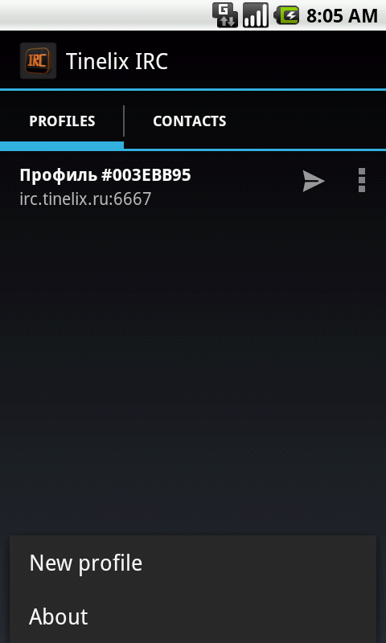
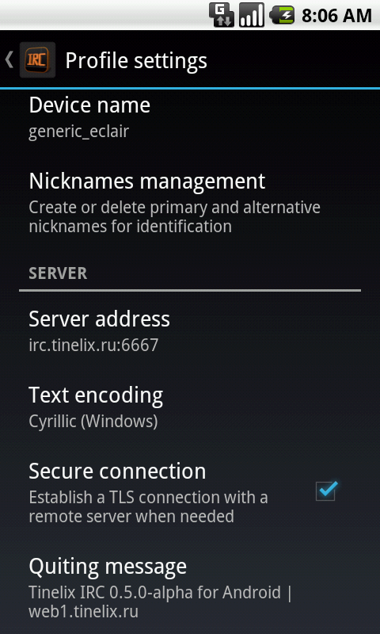
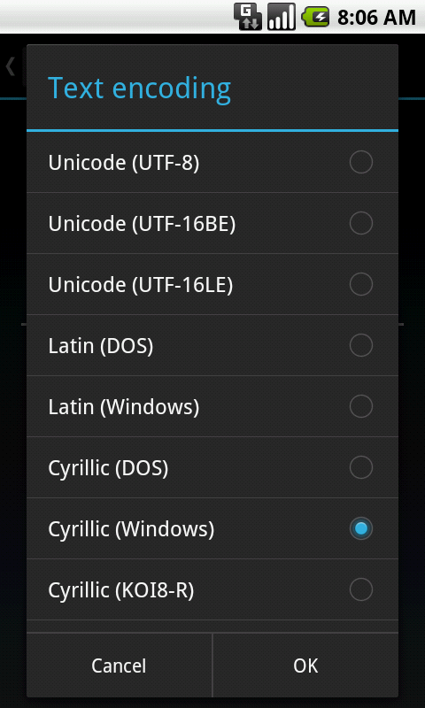
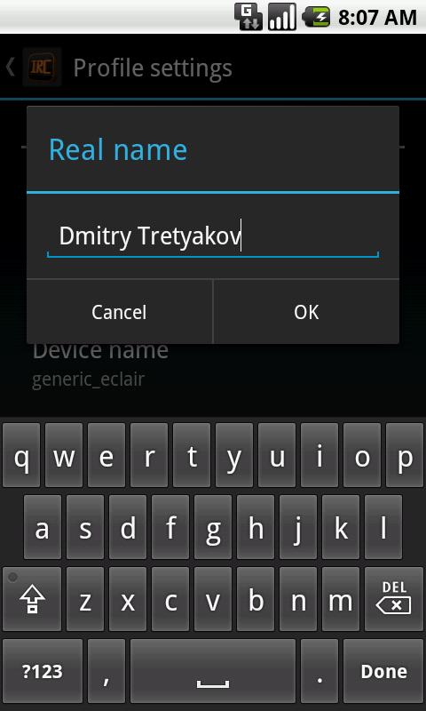
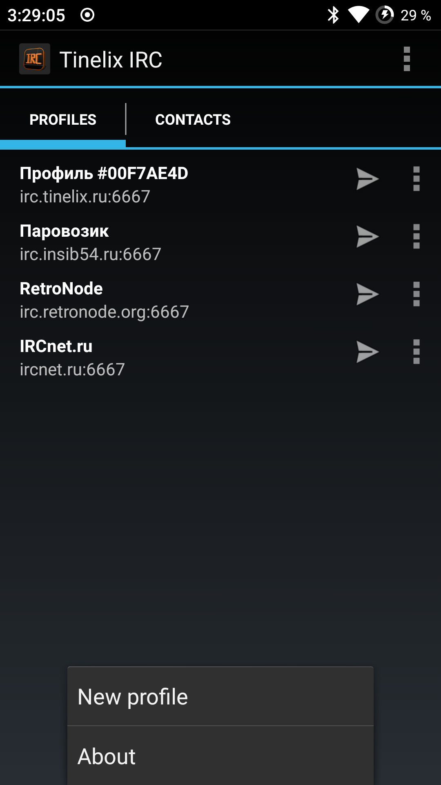
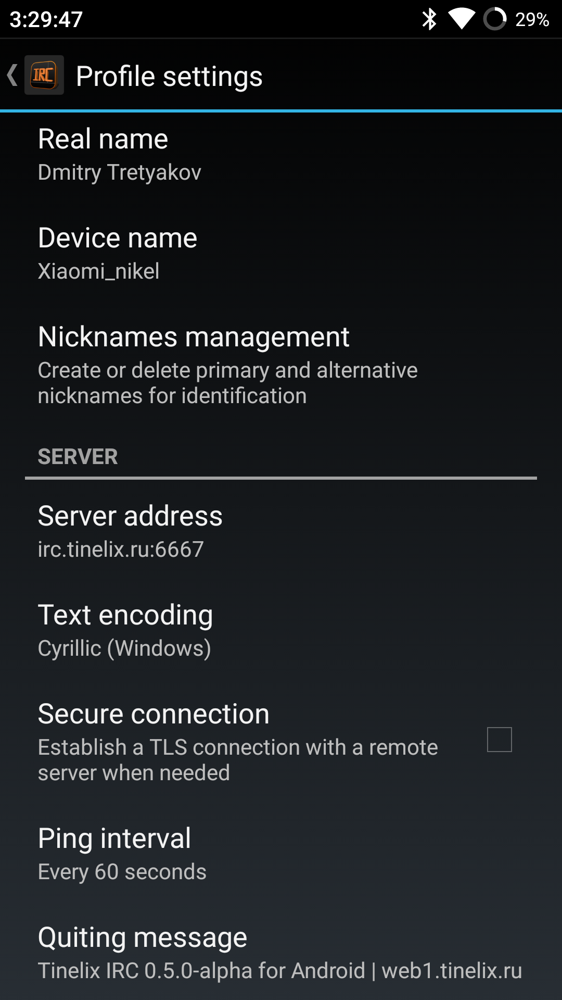
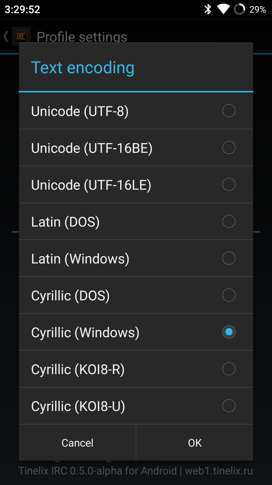
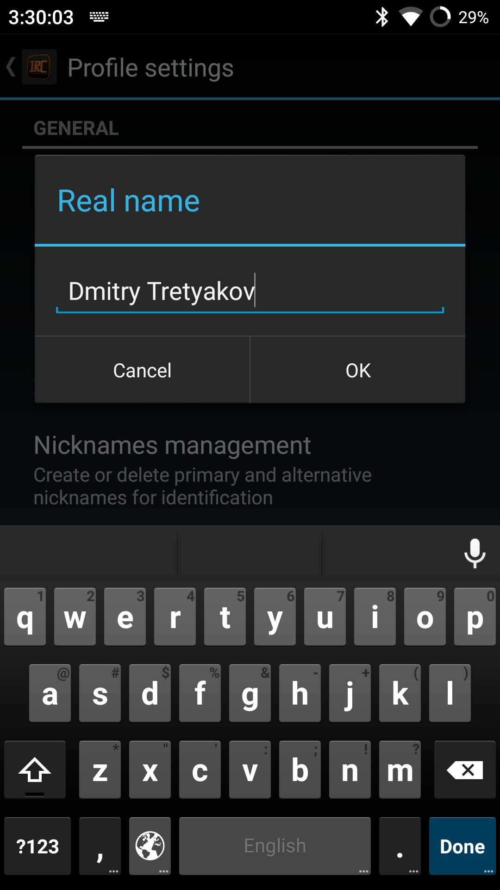

# Holo User Experience Library (Holo3/4 UX)
Android Holo UX backward compatibility library for Android 2.x and above with native Android View

### Holo4UX

**Holo4UX** is a reimplementation of the Holo theme from Android 4.x with backward compatibility for Android 2.x. For Android 4.0 and higher, it uses the original _Theme.Holo_ styles family.

### Screenshots

#### Holo4UX for Android 2.x

   

#### Native Holo for Android 4.x and above

   

### How to use in your project

Configure your application's theme to use _Holo4UX.Theme_ in `styles.xml`, `themes.xml`, or `AndroidManifest.xml`.

#### styles.xml / themes.xml

```xml
<style name="AppTheme" parent="Holo4UX.Theme">
	<!-- any customizations here !-->
</style>
```

#### AndroidManifest.xml

```xml
	<application
		<!-- ... !-->
		android:theme="@style/AppTheme" <!-- or Holo4UX.Theme !-->
		<!-- ... !-->
	>
	</application>
```


**NOTE:** _Holo4UX.Theme_ is available only in a dark version. A light version is planned for the future.

### License

References from [Android 4.1.2 Jelly Bean raster resources](https://android.googlesource.com/platform/frameworks/base/+/refs/tags/android-4.1.2_r2.1/core/res/res/) and [Holo Design Stencils](https://developer.android.com/downloads/design/Android_Design_Downloads_20120823.zip).

_You may use these materials without restriction to develop your apps and to use in your apps._

```
  Copyright (C) 2013 The Android Open Source Project
  Copyright (C) 2026 Dmitry Tretyakov
  
  Licensed under the Apache License, Version 2.0 (the "License");
  you may not use this file except in compliance with the License.
  
  You may obtain a copy of the License at
  
        http://www.apache.org/licenses/LICENSE-2.0

  Unless required by applicable law or agreed to in writing, software
  distributed under the License is distributed on an "AS IS" BASIS,
  WITHOUT WARRANTIES OR CONDITIONS OF ANY KIND, either express or implied.
  See the License for the specific language governing permissions and
  limitations under the License.
```